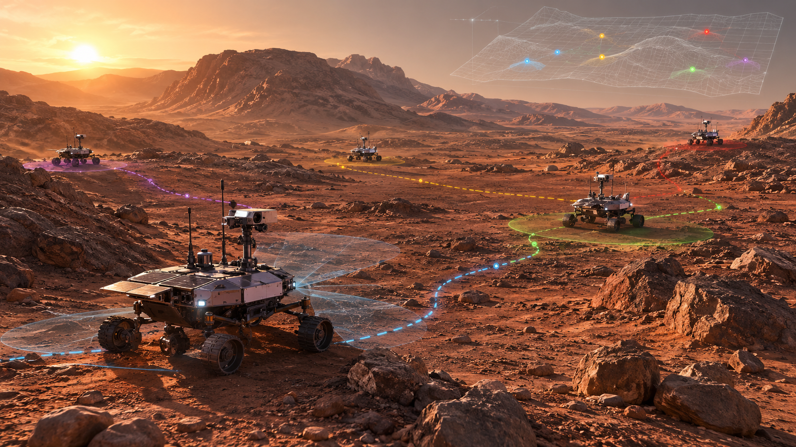
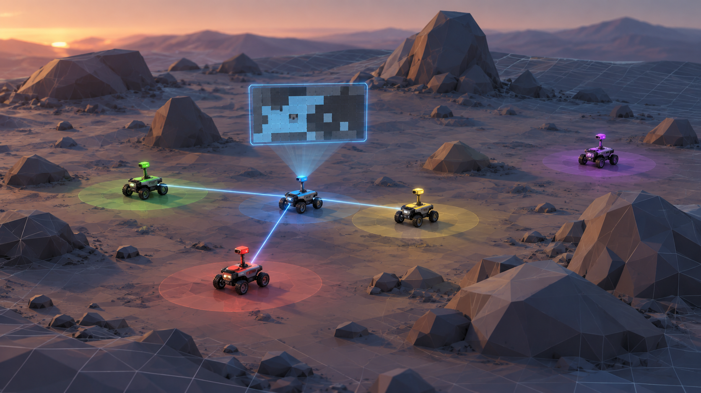

<p align="center">
  
</p>

<p align="center"><sub><i>Illustrative artwork only, not output from the simulator.</i></sub></p>

# Multi-Robot Exploration: Communication and Wasted Effort

Imagine a team of robots sent into a building, a cave, the surface of a new planet, or any other unexplored terrain with no map. Each robot explores on its own and can share what it has learned only with teammates close enough to communicate with. The goal is to map the terrain as efficiently as possible, but limited communication gets in the way: a robot that is out of range of its teammates can end up mapping ground that another robot has already explored, without knowing it. This project studies that duplicated work.

Specifically, I'm studying how the *pattern* of communication over time (which robots can communicate with each other, and how often) shapes how much exploration effort is wasted. All of the work is done in grid simulations; there is no hardware involved.

This is undergraduate research at Lehigh University, supervised by Prof. Hsuan-Wei Lee.

## The question

**How does the communication network's connectivity over time determine how much exploration effort is wasted?**

When robots explore without a shared map, they can only learn what their teammates have found by communicating with them. A robot that hasn't heard from a teammate may map an area that teammate already covered, and that duplicated work is the wasted effort this project measures. At any moment, the team's communication can be represented as a network: each robot is a node (a point in the network), and two robots are linked when they are within communication range. A standard measure of how well connected such a network is, the **algebraic connectivity (λ₂)**, is a single number calculated from the pattern of links that reflects how hard it is to split the team into groups that cannot communicate. It is zero when the team is already split and grows as the robots become more strongly linked. But λ₂ describes the network at a single instant. As robots move, links form and break, so what determines wasted effort is how information spreads across the team over the whole run. We expect temporal measures, such as how often robots meet and how out of date their information about each other is, to explain wasted effort better than snapshot measures like λ₂.


## Where things stand

At this stage, I've completed the planning of the simulation and am working on implementing it. There are no results yet. Every design decision, and the reasoning behind it, is in the full plan: [`docs/simulation-plan.md`](docs/simulation-plan.md).

## How the simulation works

<p align="center">
  
</p>

<p align="center"><sub><i>An artist's interpretation of the setup, not a frame from the actual simulator. Robots within communication range link up and merge their maps, while the purple robot is out of range and exploring on its own.</i></sub></p>

Each trial is a single exploration run on a single map, and it works as follows.

- **The world** is a grid of cells, each either open or a wall. Walls are placed at random, and every trial uses a newly generated map. Maps where some open cell cannot be reached from the others are discarded. The grid is sized so there are about 300 open cells per robot, which keeps the area each robot is responsible for roughly constant as the team grows.
- **Time** advances in discrete steps. On each step, every robot either moves one cell (up, down, left or right) or stays where it is.
- **The robots** know their exact positions and sense without error. Each step, a robot observes every cell within 5 cells of it that is in its line of sight, which is traced with Bresenham's line algorithm (a standard method for drawing straight lines on a grid). Walls block the view. Robots do not collide, and all of them start near a single entrance.
- **Each robot keeps its own map** of the cells it knows to be open, known to be walls, or still unknown.
- **Decisions** are deliberately simple. Each robot heads for the nearest frontier on its own map (a known open cell next to an unknown one), found by breadth-first search over the cells it knows are open. Robots do not coordinate, so several may choose the same frontier. A robot picks a new goal as soon as its current one stops being a frontier.
- **Communication** is the only way information moves between robots. Two robots are linked when they are closer than a communication range r_c. Robots connected by a link, or by a chain of links through other robots, form a group, and every robot in a group receives the group's combined map each step.
- **A run ends** when the team as a whole has observed every open cell, or after a step limit of four times the number of open cells, whichever comes first.

### What is varied

- **Team size** N ∈ {1, 2, 4, 8, 16, 32}.
- **Communication range** r_c ∈ {0, 3, 6, 12, unlimited}, measured in cells. A range of 0 means no communication at all; an unlimited range means every robot is always linked to every other.
- **At least 100 trials** for each combination. Trials are paired across ranges: for a given team size, trial *k* uses the same map, starting cells and random choices at every range, so the only thing that differs is r_c.

### What is measured

- **Coverage:** the fraction of open cells observed by at least one robot, tracked over time.
- **Wasted effort (W):** the running count of repeated discoveries. A repeated discovery happens when a robot observes an open cell that is unknown on its own map, even though another robot already observed that cell on an earlier step.
- **Mean degree:** the average number of direct links each robot has.
- **Algebraic connectivity (λ₂):** as described above, computed at every step.
- **Connected fraction:** the share of steps in which every robot can reach every other through links.
- **Information age:** for each pair of robots, how many steps have passed since one last received an update from the other, either directly or relayed through teammates.
- **Meetings:** the moments when a link forms between two robots that were not linked on the previous step.

### Checks before collecting results

The simulator has to pass two sanity checks before its results can be trusted. With r_c = 0, every robot should behave exactly as it would if it were exploring alone. With unlimited range, every robot should hold the same map after each sharing step, as if the whole team shared a single map.

The main figure will show wasted effort per open cell against communication range, with one line for each team size.

## What's in the repo

```text
configs/   experiment settings
docs/      simulation plan
figures/   plots made from results
img/       illustrative images (not experiment output)
results/   raw and summarized trial output
src/       simulator code
tests/     automated checks
```

## Tools

Python, NumPy, SciPy, matplotlib, pandas, and pytest.

## Setup

You need Python 3.10 or newer. From the project folder, create a virtual environment and install the dependencies:

```bash
python3 -m venv .venv
source .venv/bin/activate      # on Windows: .venv\Scripts\activate
pip install -r requirements.txt
```

Once the simulator is implemented, run the automated checks with:

```bash
pytest
```

## Reproducibility

Every random choice in the project comes from a single recorded master seed (a starting number for the random number generator). From it, separate random streams are drawn for map generation, starting positions, and each robot's tie-breaking between equally good goals. Each trial's seed is assigned before any trial runs, so running the trials in a different order, or in parallel, gives exactly the same results.

## Further reading

- [`docs/simulation-plan.md`](docs/simulation-plan.md): the full plan, the decisions behind it, and the questions that are still open.

## License

Released under the MIT License. See [`LICENSE`](LICENSE).
