<p align="center">
  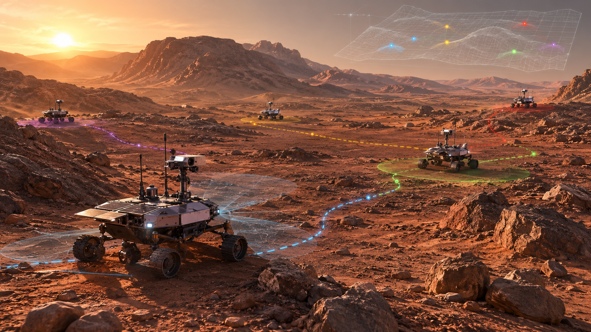
</p>

<p align="center"><sub><i>Illustrative artwork only, not output from the simulator.</i></sub></p>

# Multi-Robot Exploration: Communication and Wasted Effort

Imagine a team of robots sent into a building, a cave, the surface of a new planet, or any other unexplored terrain with no map. Each robot explores on its own and can share what it has learned only with teammates close enough to communicate with. The goal is to map the terrain as efficiently as possible, but limited communication gets in the way: a robot that is out of range of its teammates can end up mapping ground that another robot has already explored, without knowing it. This project studies that duplicated work.

Specifically, I'm studying how the *pattern* of communication over time (which robots can communicate with each other, and how often) shapes how much exploration effort is wasted. All of the work is done in grid simulations; there is no hardware involved.

This is undergraduate research at Lehigh University, supervised by Prof. Hsuan-Wei Lee.

## The question

**How does the communication network's connectivity over time determine how much exploration effort is wasted?**

When robots explore without a shared map, they can only learn what their teammates have found by communicating with them. A robot that hasn't heard from a teammate may map an area that teammate already covered, and that duplicated work is the wasted effort this project measures.

<p align="center">
  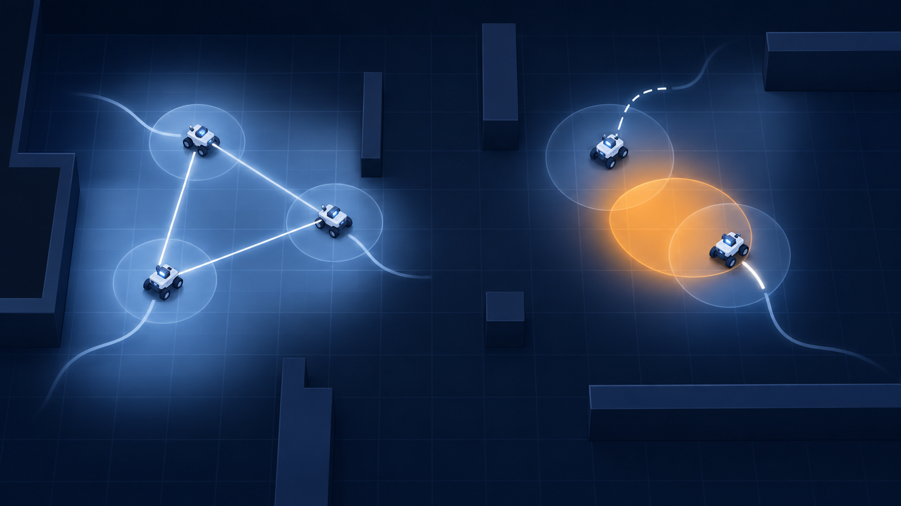
</p>

<p align="center"><sub><i>Robots linked into a network (left) share maps and avoid repeating each other's work. Robots that are out of range (right) cannot share what they find, so both explore the same area (orange): wasted effort.</i></sub></p>

At any moment, the team's communication can be represented as a network: each robot is a node (a point in the network), and two robots are linked when they are within communication range. A standard measure of how well connected such a network is, the **algebraic connectivity (λ₂)**, is a single number calculated from the pattern of links that reflects how hard it is to split the team into groups that cannot communicate. It is zero when the team is already split and grows as the robots become more strongly linked. But λ₂ describes the network at a single instant. As robots move, links form and break, so what determines wasted effort is how information spreads across the team over the whole run. We expect temporal measures, such as how often robots meet and how out of date their information about each other is, to explain wasted effort better than snapshot measures like λ₂.


## Where things stand

- **Done:** the simulator, the sweep runner, the analysis scripts, the run animator, and **Fieldwork**, a local dashboard for running and inspecting experiments. All 38 automated tests pass, including both sanity checks below.
- **In progress:** reviewing the code to make sure it matches the simulation plan and the goals of the experiment, before any results are collected.
- **Next:** once the review is done, run the small `core` sweep (team sizes 1, 2 and 4 at the two communication extremes), then the `pilot` sweep (the full design at 20 trials per setting), and review the pilot with Prof. Lee before committing to the full 100-trial `main` sweep.

No results have been reported yet; numbers in the screenshots below come from short test runs used to build and check the dashboard, and are not findings. Every design decision, and the reasoning behind it, is in the full plan: [`docs/simulation-plan.md`](docs/simulation-plan.md).

## How the simulation works

<p align="center">
  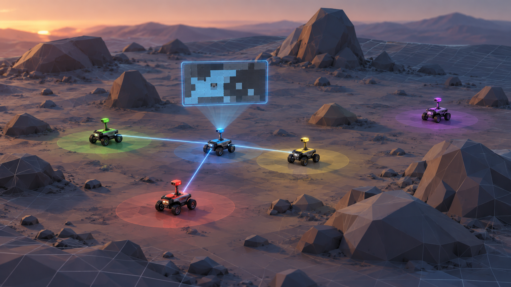
</p>

<p align="center"><sub><i>An artist's interpretation of the setup, not a frame from the actual simulator. Robots within communication range link up and merge their maps, while the purple robot is out of range and exploring on its own.</i></sub></p>

Each trial is a single exploration run on a single map, and it works as follows.

- **The world** is a grid of cells, each either open or a wall. Walls are placed at random, and every trial uses a newly generated map. Maps where some open cell cannot be reached from the others are discarded. The grid is sized so there are about 300 open cells per robot, which keeps the area each robot is responsible for roughly constant as the team grows.
- **Time** advances in discrete steps. On each step, every robot either moves one cell (up, down, left or right) or stays where it is.
- **The robots** know their exact positions and sense without error. Each step, a robot observes every cell within 5 cells of it that is in its line of sight, which is traced with Bresenham's line algorithm (a standard method for drawing straight lines on a grid). Walls block the view. Robots do not collide, and all of them start near a single entrance.
- **Each robot keeps its own map** of the cells it knows to be open, known to be walls, or still unknown.
- **Decisions** are deliberately simple. Each robot heads for the nearest frontier on its own map (a known open cell next to an unknown one), found by breadth-first search over the cells it knows are open. Robots do not coordinate, so several may choose the same frontier. A robot picks a new goal as soon as its current one stops being a frontier.
- **Communication** is the only way information moves between robots. Two robots are linked when they are closer than a communication range r_c. Robots connected by a link, or by a chain of links through other robots, form a group, and every robot in a group receives the group's combined map each step.
- **A run ends** when the team as a whole has observed every open cell, or after a step limit of four times the number of open cells, whichever comes first.

### What is varied

- **Team size** N ∈ {1, 2, 4, 8, 16, 32}.
- **Communication range** r_c ∈ {0, 3, 6, 12, unlimited}, measured in cells. A range of 0 means no communication at all; an unlimited range means every robot is always linked to every other.
- **At least 100 trials** for each combination. Trials are paired across ranges: for a given team size, trial *k* uses the same map, starting cells and random choices at every range, so the only thing that differs is r_c.

### What is measured

- **Coverage:** the fraction of open cells observed by at least one robot, tracked over time.
- **Wasted effort (W):** the running count of repeated discoveries. A repeated discovery happens when a robot observes an open cell that is unknown on its own map, even though another robot already observed that cell on an earlier step.
- **Mean degree:** the average number of direct links each robot has.
- **Algebraic connectivity (λ₂):** as described above, computed at every step.
- **Connected fraction:** the share of steps in which every robot can reach every other through links.
- **Information age:** for each pair of robots, how many steps have passed since one last received an update from the other, either directly or relayed through teammates.
- **Meetings:** the moments when a link forms between two robots that were not linked on the previous step.

### Checks before collecting results

The simulator has to pass two sanity checks before its results can be trusted. With r_c = 0, every robot should behave exactly as it would if it were exploring alone. With unlimited range, every robot should hold the same map after each sharing step, as if the whole team shared a single map.

The main figure will show wasted effort per open cell against communication range, with one line for each team size.

## What's in the repo

```text
configs/   experiment settings, one JSON file per sweep
docs/      simulation plan
figures/   plots and animations made from results
img/       illustrative images (not experiment output)
results/   raw and summarized trial output
src/       simulator code
tests/     automated checks
```

Inside `src/`:

- `simulator.py` is the simulation itself: map generation, sensing, frontier choice, communication, map sharing and the wasted-effort count.
- `experiment.py` runs a whole sweep of trials in parallel and saves the results.
- `analysis.py` turns a results folder into figures and summary tables.
- `animate.py` draws a single run as an animated GIF.
- `dashboard.py` serves the local experiment dashboard.

`tests/` holds three groups of checks: `test_sanity_checks.py` (the two checks described above), `test_components.py` (map generation, movement, sensing, frontiers, goal choice, links and the wasted-effort count) and `test_dashboard.py` (the dashboard produces the same trials as the command line).

## Tools

Python, NumPy, SciPy, matplotlib, pandas, and pytest. The dashboard uses only Python's standard library web server and plain HTML, CSS and JavaScript, so it needs nothing beyond `requirements.txt`. [FFmpeg](https://ffmpeg.org) is optional; with it, exploration videos are saved as MP4 instead of GIF.

## Setup

You need Python 3.10 or newer. From the project folder, create a virtual environment and install the dependencies:

```bash
python3 -m venv .venv
source .venv/bin/activate      # on Windows: .venv\Scripts\activate
pip install -r requirements.txt
```

Then run the automated checks, which include the sanity checks above:

```bash
pytest
```

## Experiment dashboard (Fieldwork)

Fieldwork is a local web dashboard for running trials, watching them, and digging into saved results without touching the command line. With the virtual environment active, start it:

```bash
python src/dashboard.py
```

Open [Fieldwork on localhost](http://127.0.0.1:8765) and keep the terminal running while you use it. Use `--port` to serve on a different port.

The dashboard calls the same code as the command line (`simulator.py`, `experiment.py`, `analysis.py` and `animate.py`) with the same seed rules, so the same settings and software version reproduce the same trial either way.

### Workspace: live trial

<p align="center">
  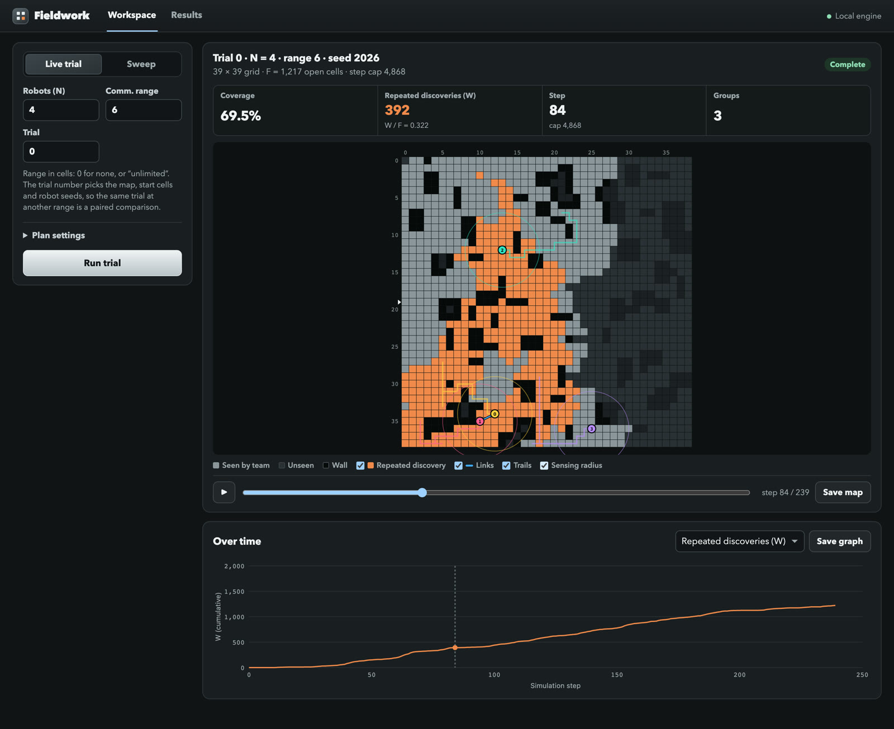
</p>

<p align="center"><sub><i>Four robots at range 6, paused at step 84 of 239. Orange cells are repeated discoveries; the chart below tracks W over the whole run, with a marker at the step shown.</i></sub></p>

- Pick a team size, communication range and trial number, then **Run trial** to watch the robots explore step by step.
- The header shows coverage, repeated discoveries (W, and W per open cell), the current step against the step cap, and how many separate communication groups the team is split into.
- Toggle map layers: repeated discoveries, communication links, trails and sensing circles.
- Drag the timeline, click the graph, or use the arrow keys to go back to any step. **Follow live** jumps back to the newest step.
- **Play** replays the run. Pick a speed from 0.25× to 8×, like a video player (1× is 20 steps per second, the pace of a live trial). Shortcuts: Space or K plays and pauses, Shift+< and Shift+> change the speed. The speed you pick is remembered.
- **Hover** over any cell or robot for details at the step shown:
  - a **cell** tells you what its color means right now: whether the team has seen it and when, whether it is a wall, and, for an orange cell, when it was first seen and when a robot rediscovered it;
  - a **robot** tells you which teammates it is linked to, which robots share its map this step, how long ago it last had contact if it is on its own, and whether it moved.
- **True map** shows the simulator's full map beside the team's view (or below it on a narrow screen), with the robots on both. Comparing the two shows how much of the real layout the team has found so far. The robots never see the true map.
- **Over time** charts coverage, repeated discoveries, mean information age, algebraic connectivity (λ₂) or the number of connected groups.
- **Save map** and **Save graph** export a PNG captioned with the settings and the step shown. When the true map is on, the saved map includes it.

<p align="center">
  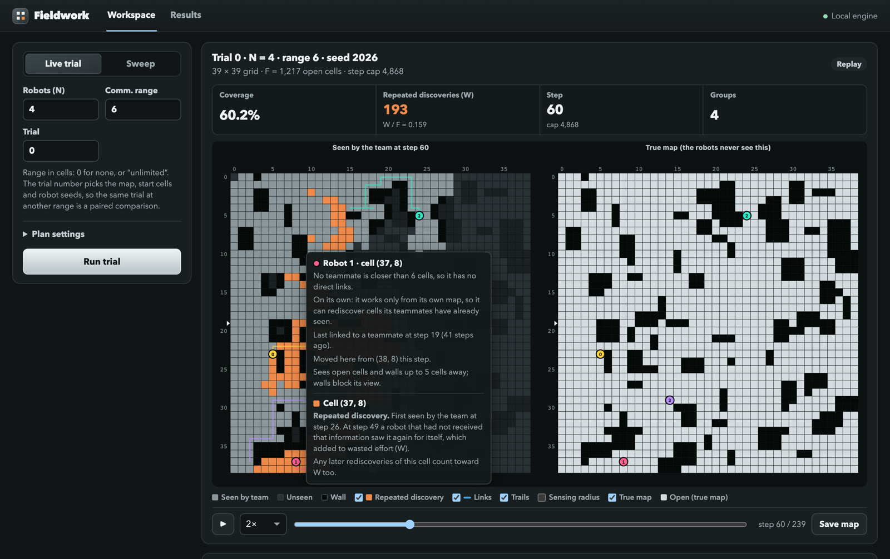
</p>

<p align="center"><sub><i>The same trial at step 60, with the true map on the right. Hovering over robot 1 shows it has been out of contact for 41 steps and is standing on a cell it rediscovered.</i></sub></p>
- Settings that differ from the plan (replanning rule, obstacle density, open cells per robot, sensing radius, step cap, seed) sit under **Plan settings**, which shows how many have been changed. **Reset to plan values** puts them back.

### Workspace: sweep

<p align="center">
  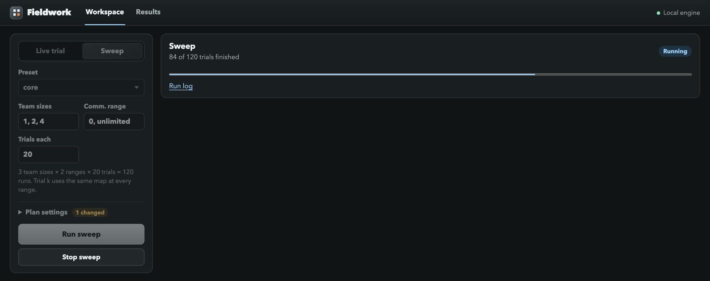
</p>

<p align="center"><sub><i>The <code>core</code> preset running: 3 team sizes × 2 ranges × 20 trials = 120 runs.</i></sub></p>

**Sweep** runs many trials in parallel. Pick a preset from `configs/`, or type comma-separated team sizes and ranges and the number of trials per setting. The form shows how many runs that adds up to; follow the progress bar or open the run log, then **Open results** when it finishes.

### Results

<p align="center">
  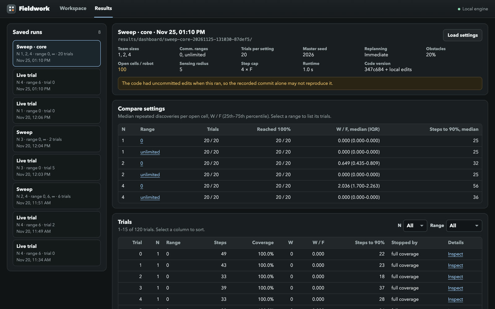
</p>

<p align="center"><sub><i>The finished <code>core</code> sweep. The yellow banner appears because this test run was made with uncommitted code changes.</i></sub></p>

<p align="center">
  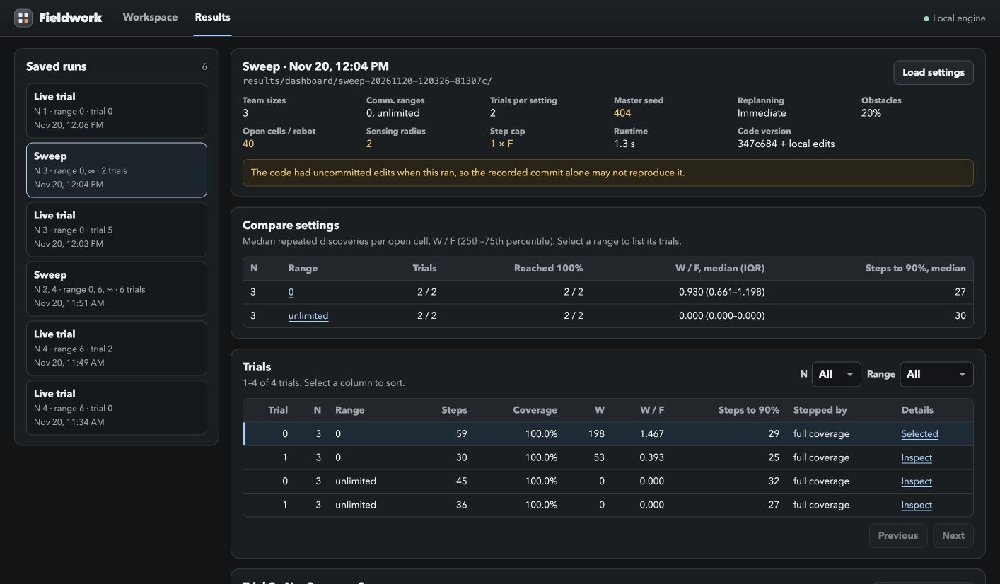
</p>

<p align="center"><sub><i>Results for a four-trial example sweep, with settings and individual trials in one view.</i></sub></p>

**Results** lists every saved run, from the dashboard and from command-line sweeps in `results/`. For the selected run it shows:

- its settings, master seed, runtime and the code version it ran on, with a warning when the code had uncommitted edits or when trials failed or hit the step cap;
- **Compare settings**: median wasted effort per open cell (with the 25th–75th percentile), the share of trials that reached full coverage, and median steps to 90% coverage, for each team size and range;
- **Trials**: every trial, sortable by any column and filterable by team size and range.

**Load settings** copies the run's settings back into the workspace.

### Inspecting a trial

<p align="center">
  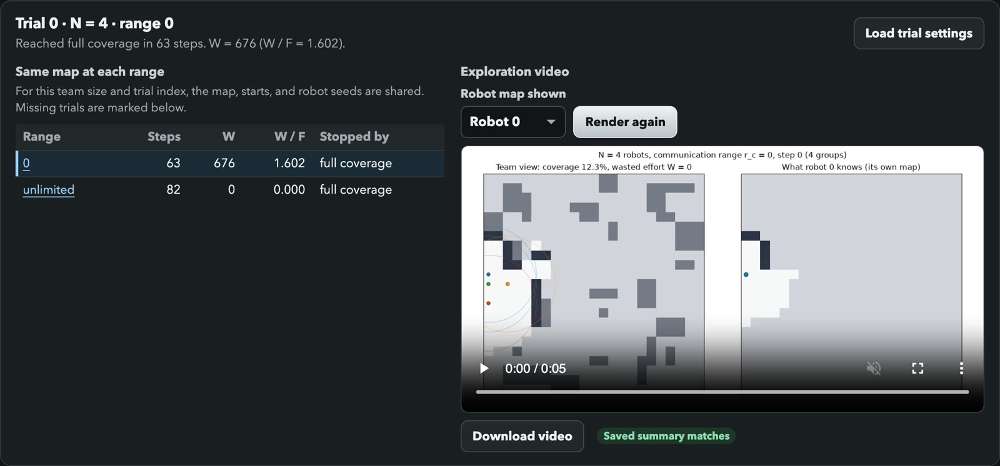
</p>

<p align="center"><sub><i>Trial 0 with four robots. On the same map, no communication cost 676 repeated discoveries; unlimited range cost none.</i></sub></p>

<p align="center">
  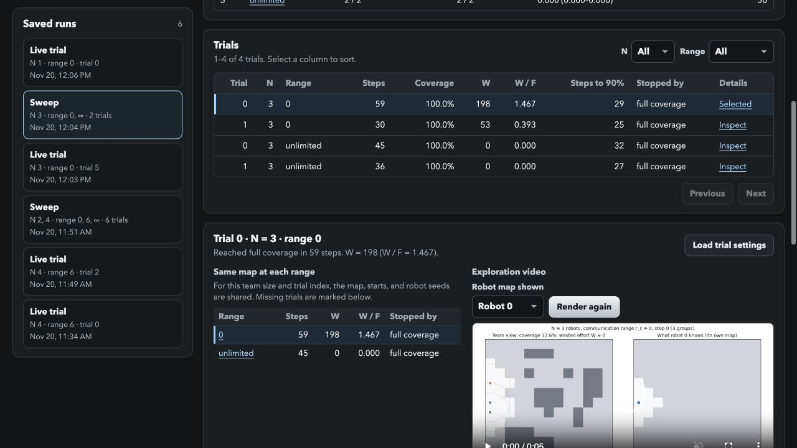
</p>

<p align="center"><sub><i>A selected trial with its paired comparison across ranges and its exploration video preview.</i></sub></p>

Selecting a trial shows the same map, starting cells and robot seeds at every communication range, side by side, so the effect of range can be read directly. **Render video** reruns the trial from its seed and saved settings and draws the team's view next to one chosen robot's own map. A video is saved only when the rerun matches the recorded starting cells, open-cell count, coverage milestones, repeats, step count and stop reason, and the dashboard says so ("Saved summary matches"). **Load trial settings** opens the trial in the live workspace.

### Figures

<p align="center">
  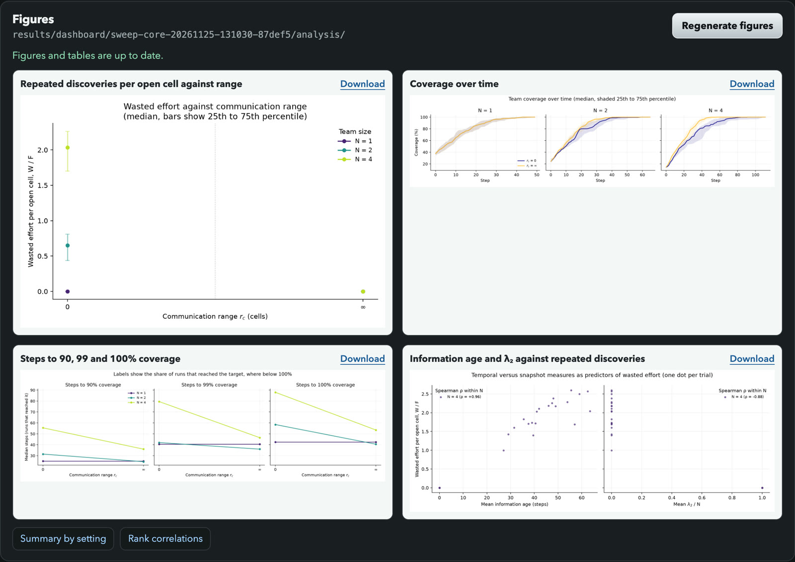
</p>

<p align="center"><sub><i>Figures generated from the <code>core</code> sweep (a small test run, not a result).</i></sub></p>

**Generate figures** runs `analysis.py` on the selected sweep and shows the plots in place, with download links for each figure, the summary table and the rank correlations. The page also links the raw data files.

Dashboard runs are saved under `results/dashboard/`, which git ignores; run the configs from the command line for results you want to keep in the repo.

## Running it from the command line

**Run a sweep.** Each file in `configs/` describes one set of trials, all with master seed 2026:

| Config | Team sizes | Ranges | Trials each | Purpose |
| --- | --- | --- | --- | --- |
| `core.json` | 1, 2, 4 | 0, unlimited | 20 | Small first check on small maps (100 open cells per robot) |
| `pilot.json` | 1–32 | 0, 3, 6, 12, unlimited | 20 | The full design at pilot scale |
| `main.json` | 1–32 | 0, 3, 6, 12, unlimited | 100 | The main experiment |
| `check_on_arrival.json` | 1–32 | 0, 3, 6, 12, unlimited | 100 | Robots pick a new goal only after arriving; paired with `main` |
| `density_10.json` | 1–32 | 0, 3, 6, 12, unlimited | 100 | Robustness check at 10% obstacles |
| `density_30.json` | 1–32 | 0, 3, 6, 12, unlimited | 100 | Robustness check at 30% obstacles |

```bash
python src/experiment.py configs/pilot.json
```

Results go to `results/pilot/`:

- `trials.csv`: one row per trial.
- `steps.csv.gz`: every step of every trial.
- `maps/`: the maps and starting cells that were used.
- `manifest.json`: the seed, software versions and git commit.

**Make the figures.**

```bash
python src/analysis.py results/pilot
```

This writes the following to `figures/pilot/`:

- the main figure (wasted effort per open cell against communication range, one line per team size)
- coverage curves
- steps to 90, 99 and 100% coverage
- information age and λ₂ plotted against wasted effort
- summary tables

**Watch a single run.**

```bash
python src/animate.py --robots 4 --range 6
```

This saves a GIF and a final-frame PNG to `figures/animations/`. The left panel shows the whole team: the cells seen so far, each robot's sensing circle, and its communication links. Cells where a repeated discovery happened are shaded orange. The right panel shows one robot's own map, so you can watch it fill in when that robot meets its teammates. Use `--range unlimited` for full communication and `--trial` to pick a different map.

## Reproducibility

Every random choice in the project comes from a single recorded master seed (a starting number for the random number generator). From it, separate random streams are drawn for map generation, starting positions, and each robot's tie-breaking between equally good goals. Each trial's seed is assigned before any trial runs, so running the trials in a different order, or in parallel, gives exactly the same results.

## Further reading

- [`docs/simulation-plan.md`](docs/simulation-plan.md): the full plan, the decisions behind it, and the questions that are still open.
- [`docs/how-the-simulation-was-built.md`](docs/how-the-simulation-was-built.md): a beginner-friendly walkthrough of the code, explaining how each part works and why it was built that way, with screenshots.

## License

Released under the MIT License. See [`LICENSE`](LICENSE).
