# How the simulation was built

This document explains how the code in this repository works and why it was built the way it was. It is written for someone who knows Python well but has not worked on simulations, robotics or network science before. You do not need to have read the code first; short excerpts are included where they help.

If you want the research design itself (what is measured and why, with references), read [`simulation-plan.md`](simulation-plan.md). This document is the companion to that plan: it shows how each part of the plan became code.

## Contents

1. [The big picture](#1-the-big-picture)
2. [Vocabulary](#2-vocabulary)
3. [How the code is organized](#3-how-the-code-is-organized)
4. [Representing maps](#4-representing-maps)
5. [Generating a random map](#5-generating-a-random-map)
6. [Placing the robots](#6-placing-the-robots)
7. [Sensing: what a robot can see](#7-sensing-what-a-robot-can-see)
8. [Deciding where to go: frontiers](#8-deciding-where-to-go-frontiers)
9. [Communication: links, groups and map sharing](#9-communication-links-groups-and-map-sharing)
10. [Counting wasted effort](#10-counting-wasted-effort)
11. [Network measures](#11-network-measures)
12. [One trial, step by step](#12-one-trial-step-by-step)
13. [Randomness and reproducibility](#13-randomness-and-reproducibility)
14. [Testing: how we know it works](#14-testing-how-we-know-it-works)
15. [Running many trials: `experiment.py`](#15-running-many-trials-experimentpy)
16. [Turning results into figures: `analysis.py`](#16-turning-results-into-figures-analysispy)
17. [Watching one run: `animate.py`](#17-watching-one-run-animatepy)
18. [The Fieldwork dashboard](#18-the-fieldwork-dashboard)
19. [Choices the plan left open](#19-choices-the-plan-left-open)
20. [Limitations](#20-limitations)

---

## 1. The big picture

A team of robots starts at the entrance of an unknown area and explores it. Each robot builds its own map from what it sees. Robots can only swap maps with teammates that are close enough to communicate with. When a robot "discovers" a cell that a teammate has already seen, that is **wasted effort**: work that sharing could in principle have avoided. The project asks how the pattern of communication over time controls how much effort is wasted.

To answer that, the code has to do four jobs:

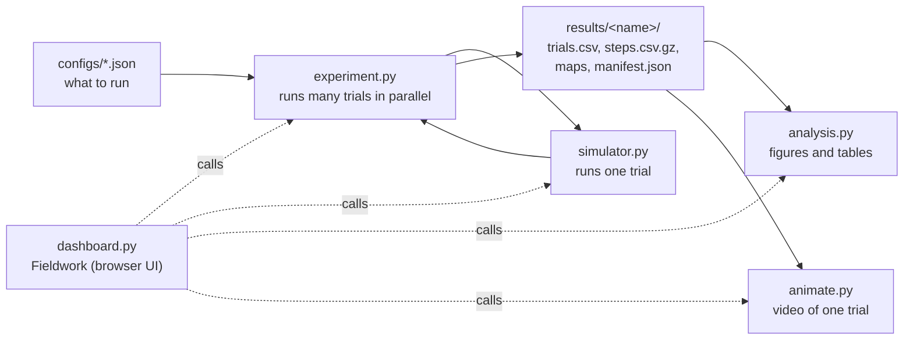

1. **Simulate one trial** (`simulator.py`): one team, one map, one communication range, from the first step to the last.
2. **Run many trials** (`experiment.py`): every combination of team size and range, many times each, in parallel, saving everything.
3. **Analyze** (`analysis.py`): turn thousands of trials into figures and summary tables.
4. **Look at it** (`animate.py` and the Fieldwork dashboard): watch individual runs so you can check that the robots behave sensibly.

A guiding rule throughout: **there is only one simulator.** The command-line tools and the dashboard all call the same `simulator.run_trial` function, so a trial run from the dashboard is identical to the same trial run from the command line. The test suite checks this.

## 2. Vocabulary

| Term | Meaning |
| --- | --- |
| **Cell** | One square of the grid. It is either open (robots can stand there) or a wall. |
| **Step** | One tick of the clock. Each step, every robot moves at most one cell. |
| **Trial** | One full exploration run on one map. |
| **Setting** | One combination of team size N and communication range r_c. |
| **F** | The number of open cells on a map. Used to make results comparable across map sizes (for example, W/F). |
| **Frontier** | A cell a robot knows is open that sits next to a cell it has never seen. Frontiers are the edge of the known world. |
| **Link** | Two robots are linked when they are close enough to talk (distance strictly less than r_c). |
| **Group** | Robots connected by links, directly or through a chain of other robots. A group shares one combined map. |
| **Coverage** | The share of open cells that at least one robot has seen. |
| **Repeated discovery** | A robot sees an open cell for the first time *itself*, but another robot already saw it on an earlier step. |
| **W** | Wasted effort: the running count of repeated discoveries. |
| **λ₂** | Algebraic connectivity, a number describing how well connected the communication network is at one instant. Zero means the team is split. |
| **Information age** | For a pair of robots, how many steps old the newest news one holds about the other is. |
| **Seed** | A number that fixes what a random number generator produces, so a run can be repeated exactly. |

## 3. How the code is organized

```text
src/
  simulator.py     the simulation: maps, sensing, decisions, communication, measures
  experiment.py    runs a sweep of trials described by a config file
  analysis.py      figures and tables from a results folder
  animate.py       a GIF or MP4 of one trial
  dashboard.py     the Fieldwork web server
  dashboard_ui/    the dashboard's HTML, CSS and JavaScript
tests/
  test_components.py     each building block on its own
  test_sanity_checks.py  the two communication extremes, and map sharing
  test_dashboard.py      the dashboard reproduces command-line trials
configs/           one JSON file per sweep
```

**Why split it this way?** Each file has one job and can be used on its own. `simulator.py` knows nothing about files, processes or plotting; it takes inputs and returns results. That makes it easy to test, and it means the code that runs the science is small enough to read in one sitting (about 850 lines). Everything about saving, scheduling and displaying lives elsewhere.

**Why plain functions and small dataclasses instead of a `Robot` class?** It is tempting to write `class Robot` with `move()`, `sense()` and so on. Here the robots are stored as rows of NumPy arrays instead (one row per robot's map, one entry per robot's position). Two reasons:

- Map sharing and measurement work on all robots at once, which is natural and fast with arrays (for example, merging a whole group's maps is one NumPy operation).
- Every robot follows exactly the same rules, so there is no behavior to put in subclasses.

The only classes are simple containers (`TrueMap`, `TrialResult`, `DiscoveryCounts`) and `Sensor`, which holds a cache.

## 4. Representing maps

Every map, true or robot, is a NumPy array of small integers:

```python
UNKNOWN = -1  # only ever appears in robot maps, never in the true map
OPEN = 0
WALL = 1
```

- The **true map** (`TrueMap.grid`) is a 2D array of `OPEN` and `WALL`. Only the simulator reads it. Robots never do.
- Each **robot map** starts as all `UNKNOWN` and fills in as the robot senses or receives teammates' maps. All robot maps are kept in one array, `maps`, with shape `(N, rows * cols)`: one flat row per robot.

**Why `int8`?** A 32-robot run has 32 maps of about 12,000 cells each, copied and compared every step. One byte per cell keeps that fast and small.

**Why flat indices?** A cell can be written as `(row, col)` or as a single number `row * width + col`. Internally the simulator mostly uses the single number, because NumPy can then pick out many cells at once with one array of indices (`maps[i, cells]`) and because integers are cheap to store in sets and dictionaries. The conversion back is `divmod(index, width)`.

**Why these particular numbers?** The order `UNKNOWN < OPEN < WALL` is deliberate. It lets map merging use `max` (section 9): taking the maximum of "unknown" and anything known always gives the known value.

## 5. Generating a random map

`generate_map` builds one random map per trial. The plan asks for:

- open ground with randomly placed walls, at a fixed obstacle density (20% in the main runs);
- about 300 open cells per robot, so the map grows with the team;
- every open cell reachable from every other.

Here is how it is done:

1. **Pick the grid size.** If we want `300 × N` open cells and 20% of cells will be walls, the grid needs about `300N / 0.8` cells in total. The grid is a square with side `ceil(sqrt(300N / 0.8))`. For 4 robots that gives a 39 × 39 grid with about 1,200 open cells.
2. **Protect the entrance.** The entrance is the middle of the left edge. Cells within 3 walking steps of it are never walls, so the robots always have room to start.
3. **Drop wall blocks one at a time.** Each block is a random rectangle 1 to 3 cells on a side. Blocks look more like real obstacles (rubble, furniture, pillars) than scattered single walls do.
4. **Reject any block that cuts the map in two.** After placing a block, `scipy.ndimage.label` counts the separate patches of open space. If there is more than one, the block is removed and another is drawn.
5. **Stop at the target density.** If too many attempts fail, the whole map is thrown away and started again.

```python
block[newly] = WALL
_, n_parts = ndimage.label(grid == OPEN, structure=_FOUR_CONNECTED)
if n_parts != 1:              # would disconnect the open space: reject block
    block[newly] = OPEN
    continue
```

**Why scale the map with the team?** If eight robots explored the same small map as one robot, most of what you would measure is crowding. Giving each robot about the same area separates "more robots" from "less space per robot". The cost, noted in the plan, is that comparisons across team sizes also compare map sizes.

**Why check connectivity block by block instead of generating a map and checking at the end?** At 20% density, a fully random map often has sealed-off pockets. Rejecting whole maps would waste a lot of work and could bias which maps survive (maps with certain shapes would be thrown out more often). Checking as you go keeps every map connected while still placing walls at random.

**Why "4-connected"?** Robots move up, down, left and right, never diagonally. Two open cells that only touch at a corner are not connected for a robot, so the check uses the same rule (`_FOUR_CONNECTED`).

## 6. Placing the robots

`choose_start_cells` puts the robots on distinct open cells within 2 walking steps of the entrance, chosen at random. If that zone has fewer cells than robots (the entrance is on the edge of the map, so the zone holds only 9 cells, which is not enough for 16 or 32 robots), the zone grows one step at a time until it fits everyone. The final zone size is recorded.

**Why all start near one entrance?** This is the classic setting for exploring an unknown building or cave: the team arrives together. It also means robots start out in communication range of each other (unless r_c = 0), so how quickly they spread out and lose contact is part of what is being studied.

**Why distinct start cells but no collisions later?** Starting on separate cells is realistic. After that, robots may share a cell and pass through each other. Modeling collisions would add path-planning rules that have nothing to do with communication and would make the results harder to interpret.

## 7. Sensing: what a robot can see

Each step, a robot sees every cell within 5 cells (straight-line distance) that is in its line of sight. Walls block the view, but the first wall along a line is itself seen. Sensing is perfect: no noise and no errors.

**Line of sight with Bresenham's algorithm.** To decide whether a robot can see a target cell, the code draws a straight line of grid cells from the robot to the target using [Bresenham's line algorithm](https://en.wikipedia.org/wiki/Bresenham%27s_line_algorithm), a standard way to approximate a line on a grid. If any cell strictly between the two ends is a wall (or off the grid), the target is hidden.

There is one extra rule, for lines that step diagonally between two walls that touch at a corner:

```text
  . W        Looking from the bottom-left to the top-right,
  W .        the line squeezes between two walls through their shared corner.
```

The view is blocked if **both** cells beside the corner are walls, because there is no gap to see through. This rule was a choice (the plan only says "a fixed rule for corner-touching lines").

**Making it fast.** Sensing happens for every robot on every step, so it is the hottest code in the simulator. `Sensor` speeds it up in two ways:

1. **Precompute the geometry once.** When a `Sensor` is created, it works out, for every offset `(dr, dc)` within the sensing circle, which cells lie on the line to it and which corners it passes. Checking visibility from a real position then becomes a handful of NumPy array lookups, with no Python loops.
2. **Cache per cell.** The true map never changes during a trial, so what is visible from a given cell is always the same. The first time a robot stands on a cell, the result is stored in a dictionary; every later visit reuses it.

**Why simple, perfect sensing?** Thousands of trials are needed, so sensing has to be cheap. More importantly, the project is about communication. If sensors made errors, some differences between settings would come from those errors rather than from communication. With perfect sensing, any difference between two ranges on the same map is caused by communication alone.

## 8. Deciding where to go: frontiers

The decision rule is deliberately simple: **go to the nearest frontier on your own map.**

A **frontier** is a cell the robot knows is open that has at least one never-seen neighbor (up, down, left or right). Walking to a frontier and looking around is how a robot learns something new. `find_frontiers` finds them all at once with array shifts: it marks every cell whose neighbor above, below, left or right is unknown.

`choose_goal` then runs a **breadth-first search** (BFS) outward from the robot's position, over cells the robot knows are open. BFS visits cells in order of walking distance, one ring at a time, so the first ring that contains any frontier holds the nearest ones.

```python
while level:
    found = [x for x in level if frontier_b[x]]
    if found:
        break
    ...  # expand to the next ring: up, down, left, right
goal = found[0] if len(found) == 1 else found[int(rng.integers(len(found)))]
```

Details that matter:

- **Ties between equally near frontiers** are broken at random, using that robot's own random number generator (see section 13). The generator is only drawn from when there actually is a tie.
- **Ties between equally short paths** are broken by a fixed order (up, down, left, right). The path is rebuilt by following each cell's "parent" back to the robot.
- **No coordination.** Robots do not reserve frontiers or divide up the map, so two robots that know the same things may head for the same spot.
- **When to choose again.** In the main runs, a robot picks a new goal as soon as its current goal stops being a frontier (because it, or a teammate it shared maps with, has now seen past it). This is "immediate" replanning. There is also an "on arrival" rule for a check run, where robots keep walking until they reach their goal even if it has already been explored.
- **No frontier at all.** The robot stays put and checks again next step.

**Why such a simple strategy?** Smarter strategies would spread robots apart on purpose, which would hide the effect being studied. With a greedy, uncoordinated rule, the only thing that keeps robots from duplicating each other's work is what they know, and what they know depends only on communication. The plan also notes that greedy robots sharing a map can clump together; if that happens, it is a finding, not a bug.

**Why BFS and not straight-line distance?** A frontier just behind a wall may be close in a straight line but far to walk to. BFS measures real walking distance through cells the robot knows are open.

## 9. Communication: links, groups and map sharing

### Links

`compute_links` returns an N × N table (an adjacency matrix) where entry `[i, j]` is `True` when robots i and j are closer than r_c:

```python
d2 = ((p[:, None, :] - p[None, :, :]) ** 2).sum(axis=-1)   # squared distances, all pairs at once
adj = d2 < r_c ** 2
```

- The comparison is **strictly less than**, so at r_c = 0 nobody is ever linked, even two robots in the same cell. That makes r_c = 0 a clean "no communication" case.
- An unlimited range is `math.inf`, which links every pair.
- **Walls do not block links.** This keeps communication a pure function of distance, so the communication network can be described by one number, r_c.

### Groups

`compute_groups` uses SciPy's `connected_components` to find groups: robots joined by links directly or through a chain. If A is linked to B and B to C, then A, B and C are one group even if A and C are far apart. Information relays through the chain instantly.

### Merging maps

Every step, each group's maps are merged into one, and every member gets the result. Because `UNKNOWN < OPEN < WALL`, merging is just an element-wise maximum:

```python
hi = stack.max(axis=0)                                     # known beats unknown
lo = np.where(stack == UNKNOWN, WALL + 1, stack).min(axis=0)
if ((lo <= WALL) & (lo != hi)).any():                      # one says OPEN, another says WALL
    raise MapDisagreementError("robots disagree about a known cell")
```

The `lo` check is a safety net. With perfect sensing, two robots can never disagree about a known cell. If they ever did, it would mean a bug, and the run stops loudly instead of silently producing wrong results.

**Why instant, unlimited sharing within a group?** Real radios have limited bandwidth, delays and dropped messages. Modeling those would add many new knobs. This project wants a single variable, connectivity, to be the only thing that controls information flow, so within a group sharing is perfect and outside a group nothing is shared. There is also no separate channel for positions: if two robots are not connected, they know nothing about each other at all.

### Timestamps for information age

Alongside maps, robots share timestamps. `u[i, j]` is the newest step at which robot i has heard (directly or relayed) from robot j. Each step, every robot stamps itself with the current step (`u[i, i] = t`), and each group takes the newest value of every column:

```python
u[g] = u[g].max(axis=0)
```

So robots in the same group are fully up to date about each other, and when news is relayed it keeps its original timestamp. The information age for a pair is then `t - u[i, j]`.

## 10. Counting wasted effort

This is the central measure, so its definition is precise. A **repeated discovery** happens when:

1. a robot observes an open cell with its own sensor,
2. that cell was unknown on its own map just before it sensed, and
3. some other robot had already observed that cell on an earlier step.

The simulator keeps a team-wide record, `first_seen`, of the step at which each cell was first seen by anyone. `count_discoveries` compares each robot's newly seen open cells against it:

```python
seen_before = first_seen[cells]
repeated_mask = (seen_before >= 0) & (seen_before < t)   # seen by someone on an earlier step
```

Two subtle decisions:

- **Counting happens before sharing.** The order inside a step is: move, sense, count, then share. If sharing came first, a robot would receive the cell from a teammate and then "see" something it already knew, and nothing would count.
- **Same-step duplicates are kept separate.** If two robots both see a cell for the very first time on the same step, neither could have known about the other's observation, and no amount of communication could have prevented it. Those cases are counted in `same_step_duplicates`, not in W.

W is reported per open cell (W/F) so that runs on maps of different sizes can be compared.

**What W does not claim.** It does not measure wasted travel or energy, and a repeated discovery does not prove that sharing would have avoided it (a robot might have gone there anyway). It is a specific, countable measure of duplicated knowledge.

## 11. Network measures

These are recorded every step:

- **Mean degree**: the average number of direct links per robot.
- **λ₂ (algebraic connectivity)**: build the Laplacian matrix `L = D − A` (D holds each robot's number of links on the diagonal, A is the adjacency matrix) and take its second-smallest eigenvalue. It is 0 whenever the team is split into more than one group and grows as the network becomes harder to cut apart. `np.linalg.eigvalsh` computes it directly, since the matrix is symmetric.
- **Connected**: whether the whole team is one group.
- **Number of groups**.
- **Mean information age**: the average of `t - u[i, j]` over all ordered pairs of different robots.
- **Meetings**: a link that exists this step but did not exist last step. Links present at step 0 do not count.

**Why record both λ₂ and information age?** That is the research question. λ₂ is a snapshot: it describes the network at one instant. Information age is temporal: it remembers how long it has been since news last flowed. The hypothesis is that the temporal measure explains wasted effort better.

For a single robot, network measures do not apply, so they are recorded as NaN ("not a number") rather than 0, to avoid mixing "not applicable" with a real zero.

## 12. One trial, step by step

`simulate()` is the heart of the project. Everything above comes together in one loop. At step `t`:

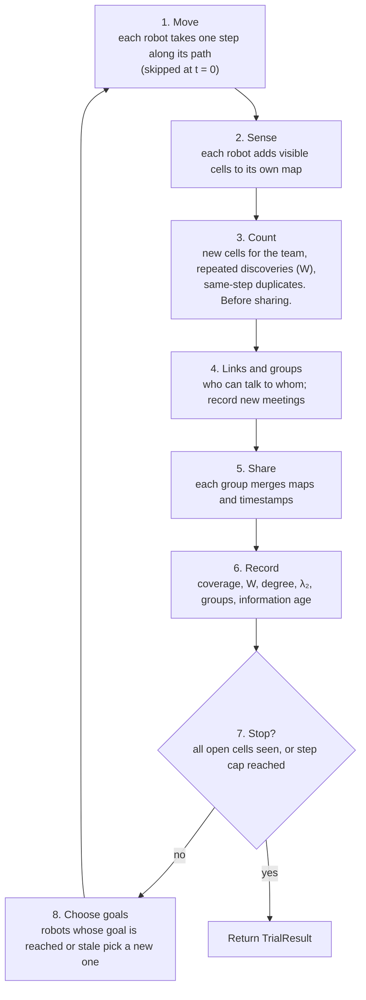

Why this order:

- **All robots move at once**, using plans made at the end of the previous step. No robot gets to react to another's move within the same step, so the robot numbering never matters.
- **Count before share**, as explained in section 10.
- **Record after sharing**, so the measures describe the state the robots will act on.
- **Stop before choosing goals**, so a finished run does not do pointless planning.

**When does a run end?** Either when the team as a whole has seen every open cell, or when the step cap of `4 × F` steps is reached. The stopping check uses the simulator's own record (`first_seen`), which robots cannot see. No robot needs to know the team is done, just as real robots would not.

The simulator also records the first step at which coverage reaches 90%, 99% and 100%. These are timestamps, not stopping rules: the run carries on past 90% and 99%. A milestone that is never reached is stored as "not reached" (NaN), never as the step cap, so it cannot be mistaken for a real time.

**Hooks for other code.** `simulate()` takes two optional callbacks. `on_step` lets the tests inspect every robot's map right after sharing. `on_frame` hands out positions, links and measures after each step; the dashboard uses it to stream a live trial. Because these are callbacks, the simulator does not need to know anything about tests or web servers.

**From one trial to one row.** `summarize()` turns a `TrialResult` into a flat dictionary (final W/F, steps to each milestone, average λ₂, average information age, meeting statistics and so on). `run_trial()` wraps everything: it builds the map and start cells from seeds, runs `simulate()`, and returns plain data that can be sent between processes.

## 13. Randomness and reproducibility

Every random choice (the map, the start cells, each robot's tie-breaking) comes from one **master seed** recorded with the results. From it, independent streams are made with NumPy's `SeedSequence`:

```python
root = np.random.SeedSequence(master_seed, spawn_key=(n_robots, trial_index))
map_seq, start_seq, robots_seq = root.spawn(3)
return map_seq, start_seq, robots_seq.spawn(n_robots)
```

Three properties follow, each on purpose:

1. **Trials are paired across ranges.** The seeds depend on the master seed, the team size and the trial number, but **not** on r_c. So trial 7 with four robots uses the same map, the same start cells and the same per-robot random streams at every communication range. When you compare r_c = 0 with r_c = 6 on trial 7, the only thing that changed is communication. This makes comparisons much sharper than comparing unrelated random runs.
2. **Order does not matter.** Each trial's seeds are fixed before anything runs, so running trials in parallel or in a different order gives identical results.
3. **Separate streams do not interfere.** Each robot has its own random generator. If robot 2 needs an extra tie-break, that does not change the random numbers robot 3 receives.

**Why `SeedSequence` instead of `seed + trial_index`?** Adding numbers to a seed can produce streams that overlap or are correlated. `SeedSequence` is NumPy's recommended way to derive many independent streams from one seed.

## 14. Testing: how we know it works

A simulator can run without crashing and still be wrong. The tests (run with `pytest`) are there to catch that. There are three files.

**`test_components.py` checks each building block on a small, hand-made case**, for example:

- generated maps are connected, the right size, and identical for the same seed;
- sensing in an empty field is a full circle, is clipped at the grid edge, is blocked by walls (while the first wall is still seen), and is blocked between two corner walls;
- frontiers are found correctly and the grid edge does not count as unknown;
- the chosen goal is the nearest frontier by walking distance, and ties are broken the same way every time;
- links use strict distance, r_c = 0 links nobody and unlimited range links everybody;
- λ₂ matches known values for simple networks;
- repeated discoveries and same-step duplicates are counted separately.

**`test_sanity_checks.py` checks the two communication extremes**, where the right answer is known in advance:

- **r_c = 0**: every robot must behave exactly as if it were exploring alone. The test runs each robot solo on the same map with the same seed and checks the paths match step for step. Network measures must all be zero.
- **r_c = unlimited**: every robot must hold the identical map after every sharing phase (as if the team shared one map), W must be 0, and λ₂ must equal N.

It also checks properties of sharing: merge order does not matter, merging a map with itself changes nothing, known cells never become unknown, relayed timestamps keep their original value, and in a three-robot chain the two end robots exchange information in one step.

**`test_dashboard.py`** checks that a live trial from the dashboard produces exactly the same results as the same trial from `experiment.py`, that bad input is rejected, and that the video reproduction check (section 18) works.

**Why test the extremes?** It is hard to know what the correct W is for r_c = 6. It is easy to know what it must be for no communication and perfect communication. If the code gets the extremes exactly right, the machinery in between (links, groups, sharing, counting) is very likely right too.

## 15. Running many trials: `experiment.py`

A sweep is described by a small JSON config file, for example `configs/pilot.json`:

```json
{
  "name": "pilot",
  "master_seed": 2026,
  "team_sizes": [1, 2, 4, 8, 16, 32],
  "comm_ranges": [0, 3, 6, 12, "unlimited"],
  "trials": 20
}
```

Anything not listed (obstacle density, sensing radius, step cap and so on) takes the plan's default value. `experiment.py`:

1. builds one job per (team size, trial, range);
2. runs them with `concurrent.futures.ProcessPoolExecutor`, one process per CPU core by default;
3. collects results as they finish, printing progress;
4. writes the results folder.

| File | Contents |
| --- | --- |
| `trials.csv` | One row per trial: settings, start cells, F, W, W/F, milestone steps, averaged network measures. |
| `steps.csv.gz` | Every measure at every step of every trial (compressed). |
| `maps/N<n>.npz` | Every map and its start cells. Saved once per (team size, trial), since the map is shared across ranges. |
| `manifest.json` | The full config, the master seed and seed rule, software versions, the git commit and whether the code had uncommitted changes, runtime, and any failed trials with their error messages. |

Design decisions:

- **Processes, not threads.** The simulation is CPU-bound Python. Python threads cannot run Python code truly in parallel, but separate processes can.
- **A failure does not stop the sweep.** Each trial runs inside a `try`; an exception is recorded in the manifest and the sweep carries on. A failure is reported loudly at the end, because it breaks the pairing for that trial across ranges.
- **Record everything needed to reproduce a result.** Seeds, versions and the git commit are saved automatically, so a result can always be traced back to the exact code and settings that produced it.

## 16. Turning results into figures: `analysis.py`

`python src/analysis.py results/pilot` reads `trials.csv` and `steps.csv.gz` and writes:

- **`wasted_effort_vs_range.png`**: the main figure. Median W/F against communication range, one line per team size, with bars from the 25th to the 75th percentile. "Unlimited" is drawn as its own category, set apart from the numeric ranges, because it is not a point on the same scale.
- **`coverage_curves.png`**: median coverage over time, one panel per team size. Runs that finish early are held at their final value, so they do not drop out of the median.
- **`steps_to_coverage.png`**: steps to 90, 99 and 100% coverage, labeled with the share of runs that reached each target.
- **`predictors.png`**: information age and λ₂ (per robot) plotted against W/F, one dot per trial, with rank correlations.
- **`summary_by_setting.csv`** and **`correlations.csv`**: the numbers behind the figures.

Statistical choices, and why:

- **Medians and quartiles instead of means and standard deviations.** W/F has long tails (a few very wasteful runs). The median is not pulled around by them.
- **Spearman rank correlation.** It asks "does more X go with more W?" without assuming a straight-line relationship.
- **Bootstrap intervals for the median.** Trials are resampled with replacement many times to see how much the median would move. Each trial is one map, so this resamples maps, as the plan asks.
- **Predictor comparisons only for N ≥ 4.** For two robots, average λ₂ is exactly twice the share of time they are connected, so comparing them tells you nothing new.
- **Held-out prediction and windowed analysis are not implemented yet**, on purpose: Prof. Lee asked to hold off until the pilot has been reviewed.

<p align="center">
  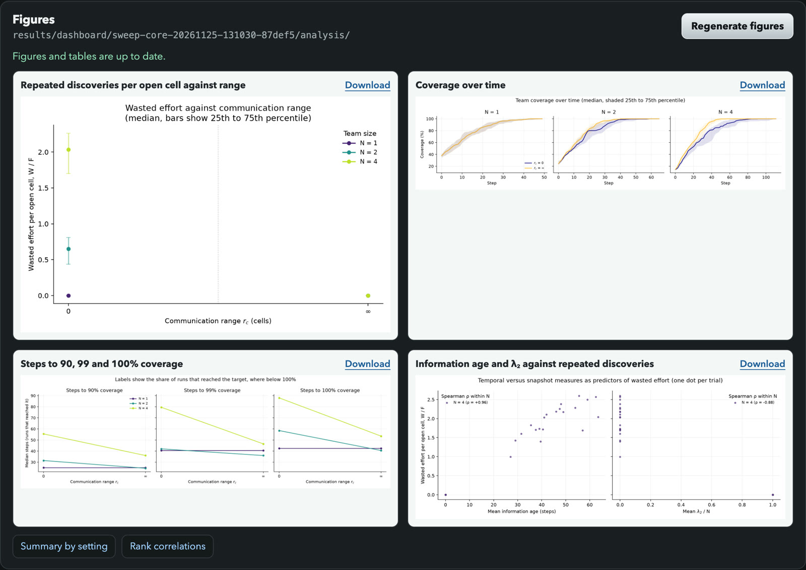
</p>

<p align="center"><sub><i>The four figures from <code>analysis.py</code>, for the small <code>core</code> test sweep (not a result).</i></sub></p>

## 17. Watching one run: `animate.py`

Numbers alone can hide bugs: a robot stuck in a corner, or a group that never shares. `animate.py` draws a run so you can see what happened.

```bash
python src/animate.py --robots 4 --range 3 --trial 1
```

<p align="center">
  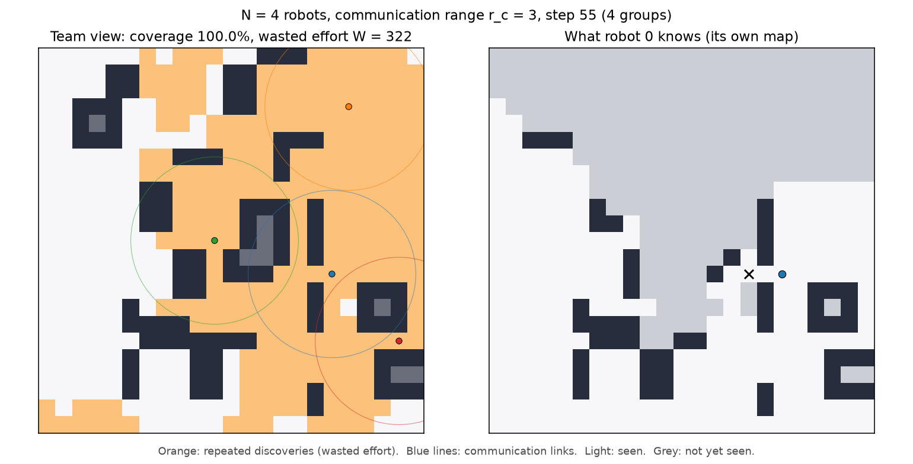
</p>

<p align="center"><sub><i>Final frame of a four-robot run at range 3 on a small map (100 open cells per robot). The team has seen everything (left), but robot 0's own map still has a large unknown area (right), because it rarely met teammates. The orange shading shows how much was rediscovered.</i></sub></p>

The **left panel** is the simulator's view: walls, what the team has seen, each robot with its sensing circle, links between robots, and orange shading where repeated discoveries happened. The **right panel** is one robot's own map. This side-by-side view is the clearest way to see the core idea of the project: the team collectively knows much more than any single robot does.

`animate.py` runs the trial with `record=True`, which makes `simulate()` keep positions, links, goals and the watched robot's map at every step. It draws frames with matplotlib and saves an MP4 if FFmpeg is installed, otherwise a GIF. Because it uses the same seeds as `experiment.py`, `--robots 4 --range 3 --trial 1` shows exactly trial 1 of a sweep.

## 18. The Fieldwork dashboard

Running sweeps from the terminal works, but checking results meant opening CSV files and image folders by hand. Fieldwork is a small web app that runs locally and puts everything in one place.

```bash
python src/dashboard.py     # then open http://127.0.0.1:8765
```

### What it looks like

**Live trial.** Pick a team size, range and trial number and watch the robots explore. You can scrub back to any step and chart any measure over time.

<p align="center">
  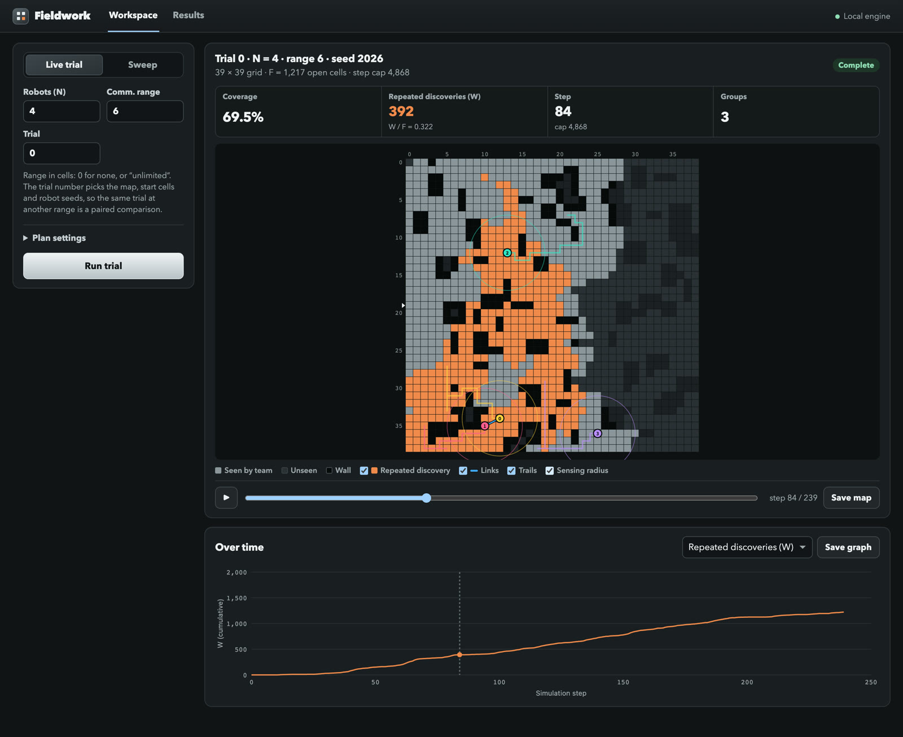
</p>

<p align="center"><sub><i>Four robots at range 6, stopped at step 84 of 239.</i></sub></p>

**Sweep.** Choose a preset from `configs/` or type your own settings, and follow the progress bar.

<p align="center">
  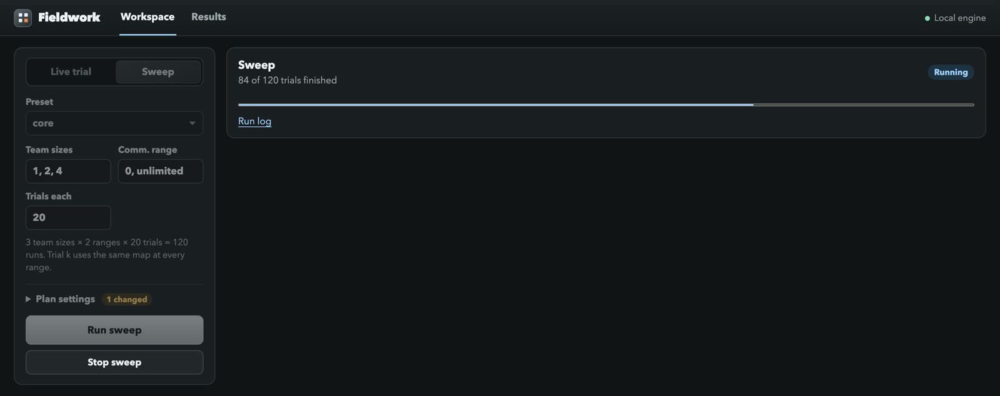
</p>

**Results.** Every saved run, its settings and code version, a table comparing settings, and a sortable table of trials.

<p align="center">
  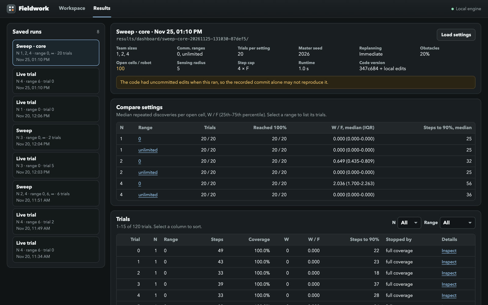
</p>

<p align="center">
  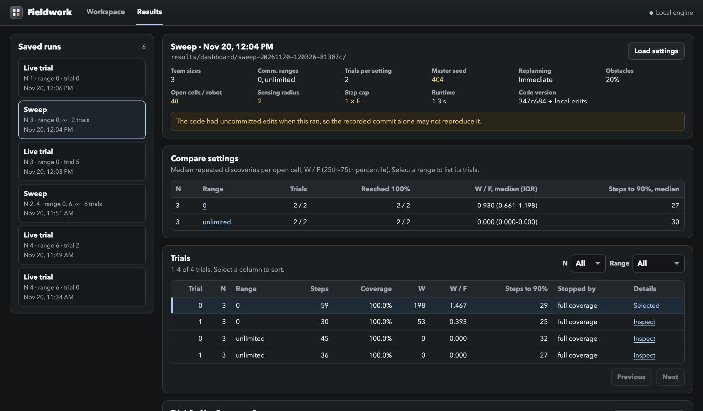
</p>

**Trial detail.** The same map at every range side by side, and a video of the trial.

<p align="center">
  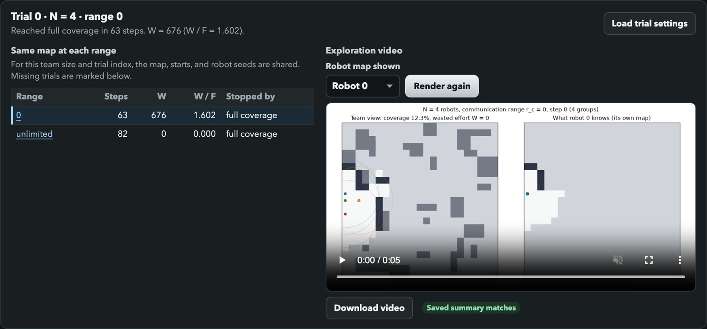
</p>

<p align="center">
  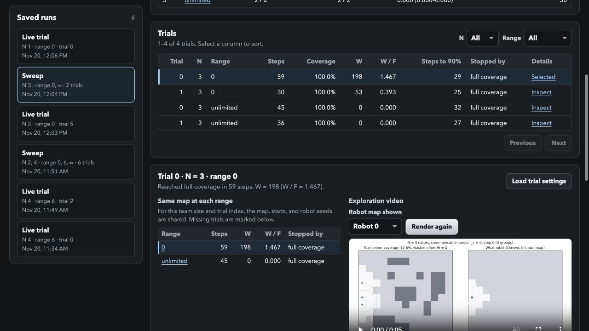
</p>

### How it is built

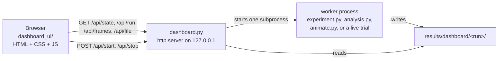

**The server is Python's built-in `http.server`.** There is no web framework (Flask, Django) and no JavaScript build step. The front end is one HTML file, one CSS file and one JavaScript file. This keeps the project's dependencies to the scientific libraries in `requirements.txt` and means there is nothing extra to install or keep updated.

**Every operation runs in its own process.** When you start a sweep, the server launches `experiment.py` as a subprocess, exactly as you would from the terminal. Figures run `analysis.py`, videos run `animate.py`, and a live trial runs `dashboard.py --trial-worker`, which calls `simulator.run_trial`. Reasons:

- **One code path.** The dashboard cannot drift away from the command line, because it *is* the command line.
- **The server stays responsive.** A long sweep does not freeze the page.
- **Stopping is clean.** The worker runs in its own process group, so **Stop** can end it and all of its child processes at once.

Only one operation runs at a time (`JobManager`), which keeps the machine from being overloaded and the status display simple. The manager reads the worker's output line by line, saves it to a log, and picks up progress lines such as `84/120 done` to drive the progress bar.

**How a live trial streams to the browser.** The worker uses the simulator's `on_frame` callback to write one line of JSON per step to `frames.jsonl` (robot positions, links, newly seen cells, repeated discoveries and the measures). It is paced at 20 steps per second so you can follow individual moves. The browser repeatedly asks the server for new frames, passing the byte offset where it stopped last time, and the server returns only the lines written since. Because every frame is saved, a finished trial can be replayed and scrubbed at any time without rerunning it.

**Videos are checked before they are saved.** Rendering a video reruns the trial from its seed. The server compares the rerun's summary (start cells, F, coverage, milestones, W, step count and stop reason) with the row saved in `trials.csv`. The video is kept only if every value matches, and the page shows "Saved summary matches". If anything differs, for example because the code changed since the sweep ran, the video is discarded and the mismatch is reported. This stops a video from silently showing something other than the trial it claims to show.

**The dashboard warns about uncommitted code.** Each run records the git commit and whether there were uncommitted changes. If there were, the Results page shows a warning that the recorded commit alone may not reproduce the run.

**Safety for a local server.** The server only listens on `127.0.0.1`, so other computers cannot reach it. Requests that start or stop processes must come from the dashboard's own page (the `Host` and `Origin` headers are checked), so another website open in your browser cannot trigger runs. File requests only serve known file names from known run folders, so a crafted URL cannot read arbitrary files. All settings are validated on the server, with limits (for example, at most 10,000 trials per sweep).

**Dashboard runs are kept separate.** They are saved under `results/dashboard/`, which git ignores, so experimenting in the dashboard does not clutter the repository. Sweeps you want to keep should be run with `experiment.py`.

## 19. Choices the plan left open

The plan fixes most rules, but a few details had to be decided while writing the code. Each is marked `CHOICE` in `simulator.py`:

| Choice | What was decided | Why |
| --- | --- | --- |
| Wall shape | Random rectangles, 1 to 3 cells per side | Looks more like real obstacles than scattered single cells, and creates corridors and dead ends. |
| Entrance | Middle of the left edge, with no walls within 3 walking steps | Robots always have room to start; one fixed rule for every map. |
| "Within 2 cells of the entrance" | Measured in walking steps | Matches how robots move. Because the entrance is on the edge, it gives the same 9 cells as straight-line distance would. |
| Corner rule for sight lines | Blocked when both cells beside a diagonal corner are walls | You cannot see through two walls that touch at a corner. |

Main settings and where they come from:

| Setting | Value | Source |
| --- | --- | --- |
| Obstacle density | 20% (10% and 30% as robustness checks) | Decisions log in the plan |
| Open cells per robot | 300 | Plan, section 2 |
| Sensing radius | 5 cells | Plan, section 3 |
| Step cap | 4 × F | Plan, section 6 |
| Replanning | Immediate (on arrival as a check run) | Plan, section 4 |
| Master seed | 2026 | Configs |

## 20. Limitations

These are known simplifications. Results describe this simulator, not real robots.

- **Grid and steps, not continuous space and seconds.** Robots move one cell per step and turn instantly.
- **Perfect sensing and positioning.** No noise, no drift, no misread walls.
- **Perfect communication within a group.** No bandwidth limit, delay or message loss, and walls do not block signals.
- **A simple, uncoordinated strategy.** Smarter strategies would waste less. That is intentional, but it means the numbers are not what a well-designed real system would achieve.
- **Map size grows with team size.** Comparisons across team sizes mix the effect of more robots with the effect of a bigger map.
- **Associations, not causes.** The analysis shows which measures go together with wasted effort inside this simulator. Paired comparisons across ranges are the strongest evidence it can give about the effect of changing r_c.

For the open questions still to be settled with Prof. Lee, see the "Open items" section of [`simulation-plan.md`](simulation-plan.md).
